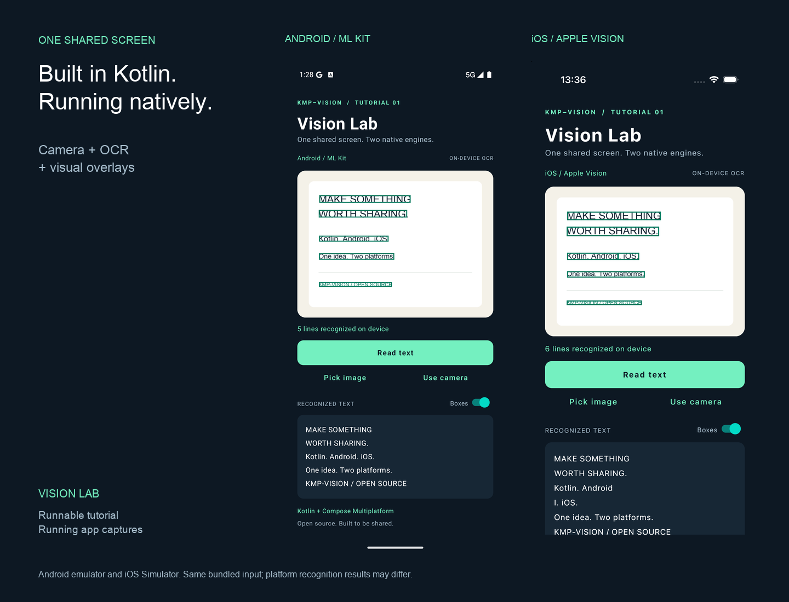
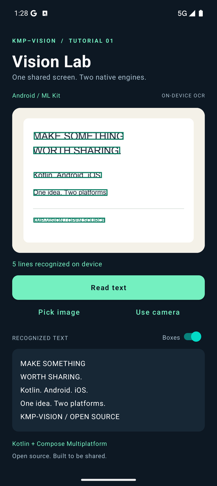
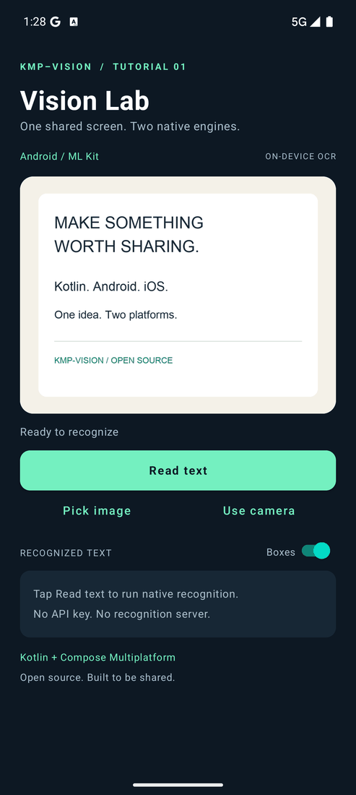
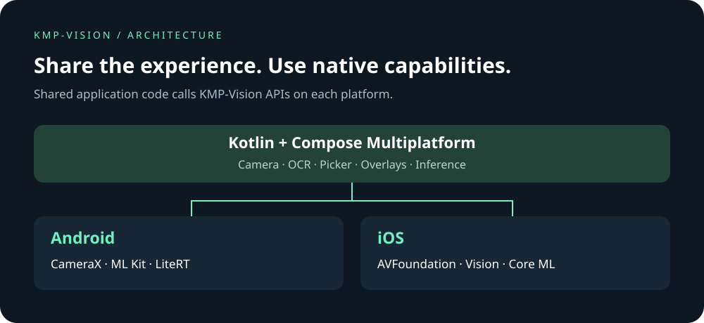

<div class="vision-hero" markdown>
<span class="eyebrow">KOTLIN MULTIPLATFORM · OPEN SOURCE</span>

# One vision.<br>Both platforms.

Build your camera-powered experience once. Bring it to **Android and iOS**.

KMP-Vision brings camera previews, text recognition, image picking, visual overlays, and on-device model inference to Kotlin and Compose Multiplatform. Write your feature logic and UI in shared code, with native implementations underneath.

[Build your first feature →](tutorial.md){ .md-button .md-button--primary }
[Explore the source](https://github.com/lamplis/kmp-vision){ .md-button }

<span class="hero-meta">Android + iOS &nbsp; / &nbsp; Native recognition engines &nbsp; / &nbsp; Apache-2.0</span>
</div>

<figure class="vision-showcase">
  
  <figcaption>One shared tutorial, running on two platforms. Real ML Kit and Apple Vision results from the bundled sample image.</figcaption>
</figure>

## Less platform plumbing. More product.

A camera feature is more than a preview. You need to get an image, analyze it, turn coordinates into something useful, and present the result. KMP-Vision brings those pieces into a shared Kotlin workflow.

<div class="grid cards" markdown>

-   **Share the feature, including the UI**

    Keep application logic and Compose screens in `commonMain`. Improve the shared implementation and bring that change to both platform builds.

-   **Put native capabilities to work**

    Use ML Kit on Android and Apple Vision on iOS through a common OCR API. Run compatible models with LiteRT and Core ML.

-   **Keep recognition on the device**

    The OCR workflow processes images locally. Get started without a recognition server or an API key.

-   **Start small. Add what you need.**

    Use OCR on its own, add overlays to an existing screen, or combine the camera and picker. The library is split into focused modules.

</div>

## From image to useful information

The **Vision Lab** tutorial is a working starting point: load an image, run native text recognition, and draw the returned boxes. The same screen also accepts photos from the system picker or camera.

<div class="vision-demo" markdown>
{ .static-preview }

<details class="animation">
<summary>Play the recognition walkthrough</summary>

</details>

*Captured from the runnable tutorial. The input is a bundled sample card; recognition results come from the platform engine. Timing in the GIF is edited for readability.*
</div>

[Follow the tutorial →](tutorial.md)

## Your building blocks

| Capability | What it gives you | Start here |
| :--- | :--- | :--- |
| **Camera** | A Compose preview, still capture, camera controls, and frames for analysis | [Camera guide](camera.md) |
| **Text recognition** | Recognized text and normalized bounding boxes through one Kotlin API | [OCR guide](ocr.md) |
| **Visual overlays** | Styleable rectangles and labels over your own content | [Overlay guide](overlay.md) |
| **Image picking** | System image selection with resize and filter options | [Picker guide](picker.md) |
| **Model inference** | A shared interface for compatible TFLite and Core ML models | [Models guide](models.md) |

Use these pieces to build text-capture tools, annotate images, or add recognition to a scanning workflow. You provide the product logic; KMP-Vision provides the integration points.

## One development effort. Native execution.

Kotlin Multiplatform lets you share code across Android and iOS. Compose Multiplatform extends that approach to the interface. KMP-Vision connects the shared layer to platform capabilities.



**What you share:** your Compose screens, recognition calls, result handling, and overlay presentation.

**What you configure per platform:** app entry points, permissions, build settings, and model assets when using inference. Build and test both applications; shared code does not imply identical OCR output or device performance.

[Install the modules](install.md) · [Understand platform differences](ocr.md#platform-behavior)

## A small API. A useful first result.

Recognize an encoded image from shared Kotlin code:

```kotlin
import io.github.lamplis.vision.ocr.OcrLine
import io.github.lamplis.vision.ocr.createOcr

suspend fun readText(encodedImage: ByteArray): List<OcrLine> {
    val recognizer = createOcr()
    return try {
        recognizer.recognize(encodedImage)
    } finally {
        recognizer.close()
    }
}
```

Each line includes text and a top-left normalized bounding box. The [complete tutorial](tutorial.md) shows image loading, state, coroutine handling, resource cleanup, and overlays. For repeated recognition, reuse a recognizer for the lifetime of the workflow and close it when that workflow finishes.

## Built to be shared

KMP-Vision is maintained by [lamplis](https://github.com/lamplis), with a simple goal: make useful mobile vision capabilities easier to build, understand, and reuse in the open.

The project brings shared Kotlin APIs, native integrations, and Compose components together in a modular toolkit. The source and tutorial are available to study, adapt, and improve under the **Apache-2.0 license**.

This work builds on the camera and picker foundations of **Peekaboo by onseok and contributors**. The OCR approach also draws inspiration from **Amirhossein Ijadi's Compose Multiplatform Text Recognition**. [Project origins and contribution guide →](contributing.md)

<div class="vision-cta" markdown>
### Your next feature can start here.

Run Vision Lab, explore the shared code, and make it yours. Bug reports, documentation improvements, and contributions help the project move forward.

[Start the tutorial](tutorial.md){ .md-button .md-button--primary }
[Contribute](contributing.md){ .md-button }
</div>
