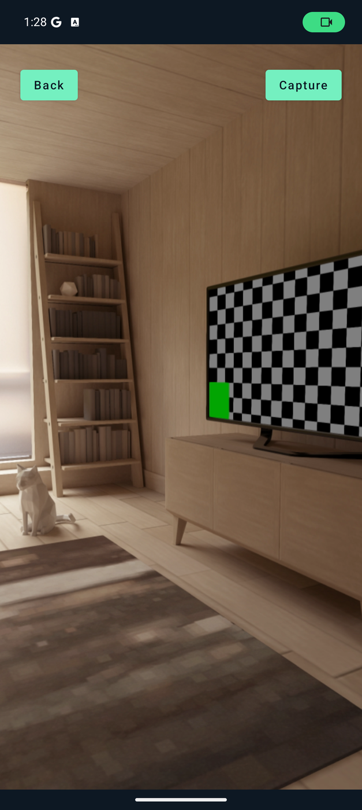
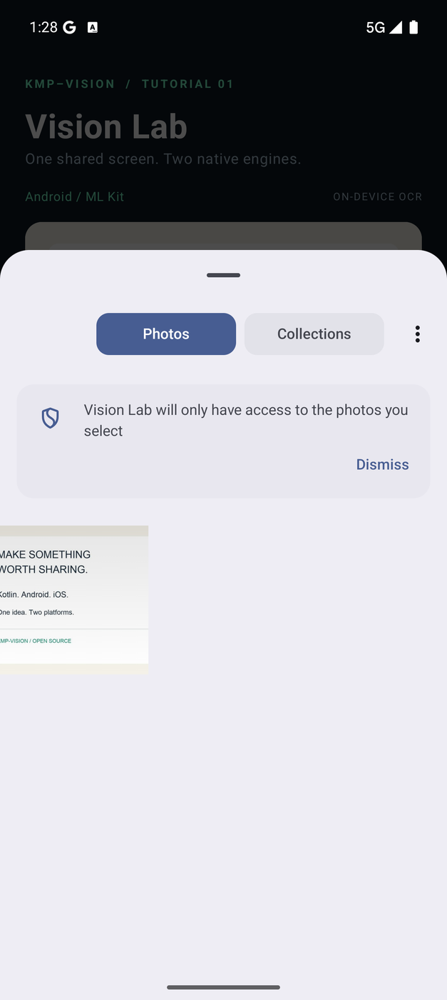
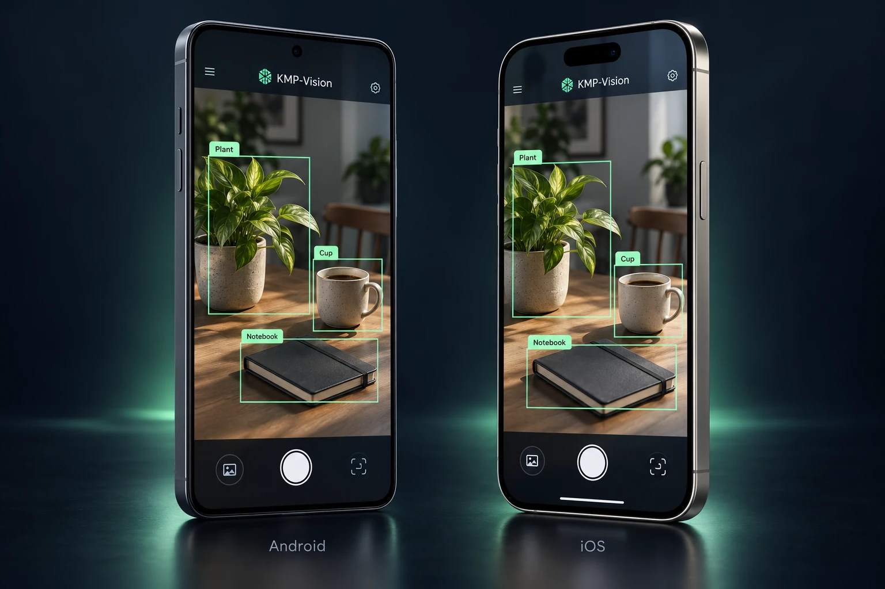
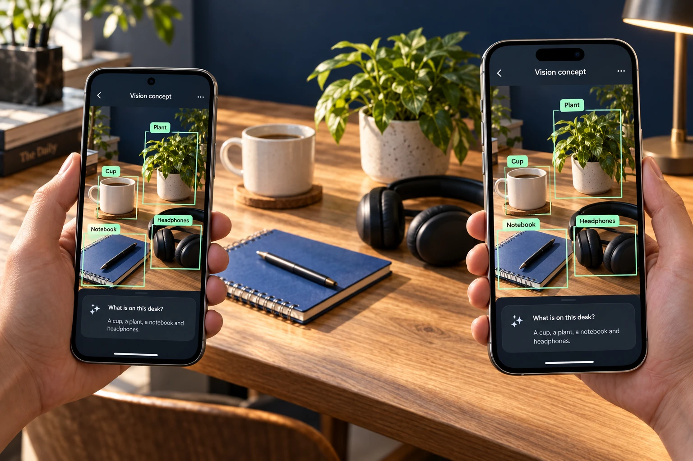

<div class="vision-hero" markdown>
<span class="eyebrow">KOTLIN MULTIPLATFORM · OPEN SOURCE</span>

# One camera toolkit.<br>Both platforms.

Build your camera and photo features once. Bring them to **Android and iOS**.

KMP-Vision simplifies everyday camera and photo workflows with Kotlin and Compose Multiplatform: show a preview, take a photo, switch cameras, control the torch, or let someone choose images from their library. Resize and filter selected images, and keep your feature logic and UI in shared code. Add OCR, overlays, or model inference whenever your product needs them.

[Build a camera feature →](camera-and-picker.md){ .md-button .md-button--primary }
[Explore the source](https://github.com/lamplis/kmp-vision){ .md-button }

<span class="hero-meta">Android + iOS &nbsp; / &nbsp; Camera · Photos · Vision &nbsp; / &nbsp; Apache-2.0</span>
</div>


## Less platform plumbing. More product.

A profile photo, a product listing, a field report, or a document attachment all start with familiar needs: open the camera, capture an image, or select one from the library. KMP-Vision brings these building blocks into a shared Kotlin workflow so you can spend more time on the experience your users need.

<div class="grid cards" markdown>

-   **Share the feature, including the UI**

    Keep application logic and Compose screens in `commonMain`. Improve the shared implementation and bring that change to both platform builds.

-   **Make camera controls part of your design**

    Embed a Compose preview, switch between front and back cameras, control the torch where available, and respond to camera readiness and capture state.

-   **Bring photos into your app**

    Capture a still photo or open the system picker for single or multiple images. Receive image bytes to display, store, or pass into your own upload workflow.

-   **Start small. Add what you need.**

    Use the camera or picker on its own. Add resizing and filters to image selection, then bring in OCR or inference only when you need recognition.

</div>

## Everything starts with a photo

Give someone a clear preview, a capture button, and a choice of camera. Or let them pick an existing image and carry on with their task. These everyday interactions are useful features on their own—no model or recognition service required.

| Your app needs to… | KMP-Vision gives you… |
| :--- | :--- |
| **Show the camera inside your UI** | A Compose preview with camera state and custom permission-denied content |
| **Take a photo** | Still capture, an optional capture aspect ratio, and an image-byte callback for your next step |
| **Fit the preview to your design** | Preview scale and orientation options for your layout |
| **Manage the camera** | Front/back switching, torch controls, readiness and capture state, and preview freezing |
| **Choose existing photos** | The system picker, single/multiple selection, and selection limits |
| **Prepare selected images** | Resize dimensions, compression quality, size thresholds, and grayscale, sepia, or invert filters |
| **Build a custom scanner** | Camera frames for your own analysis and styleable result overlays |

<div class="grid cards" markdown>

-   **Capture a new photo**

    { .camera-feature-preview loading=lazy }

    A real camera preview from the Android tutorial, using the emulator's virtual scene. Add your own capture flow and controls.

    [Explore camera management →](camera.md)

-   **Choose a photo you already have**

    { .camera-feature-preview loading=lazy }

    Open familiar system photo selection from shared code, then prepare the selected images for your app.

    [Explore photo picking and filters →](picker.md)

</div>

[Build a camera and picker screen](camera-and-picker.md){ .md-button .md-button--primary }
[Run the tutorial](tutorial.md){ .md-button }

## Add intelligence when the feature calls for it

<figure class="vision-showcase">
  
  <figcaption>One shared vision, two familiar platforms. AI-generated concept illustration; object detection requires your own compatible model and integration.</figcaption>
</figure>

### Give your camera a vocabulary

Point at a desk. Find the notebook. Highlight the headphones. Turn a camera frame into something your app can act on.

Imagine a workspace assistant that helps someone find an item, a cataloguing tool that turns a photo into a reviewable list, or a camera experience that answers **“What is on this desk?”** The product starts with what the user wants to do; the model supplies information your shared Kotlin code can turn into an interface.

<figure class="vision-showcase">
  
  <figcaption>Imagine the experience: identify objects, then help someone act. AI-generated concept, with illustrative detections and answers.</figcaption>
</figure>

<div class="grid cards" markdown>

-   **Point**

    Bring an image into your shared workflow from the camera or system picker.

-   **Recognize**

    Run your compatible model, interpret its outputs, and highlight the objects that matter with Compose overlays.

-   **Respond**

    Turn results into a useful action: select an item, review a list, or explore a scene through a separately integrated vision-language experience.

</div>

**Build the experience around your model.** KMP-Vision supplies camera, tensor-inference, and overlay building blocks. It does not bundle an object detector or an LLM/vision-language model. Object recognition needs a compatible model and its preprocessing and output decoding; visual question answering needs an additional model/runtime or service integration.

[Explore object recognition and vision-language app concepts →](models.md)

## From image to useful information

The **Vision Lab** tutorial is a working starting point: load an image, run native text recognition, and draw the returned boxes. The same screen also accepts photos from the system picker or camera.

<div class="vision-demo" markdown>
{ .static-preview }

<details class="animation">
<summary>Play the recognition walkthrough</summary>

</details>

*Captured from the runnable tutorial. The input is a bundled sample card; recognition results come from the platform engine. Timing in the GIF is edited for readability.*
</div>

[Follow the tutorial →](tutorial.md)

## Your building blocks

| Capability | What it gives you | Start here |
| :--- | :--- | :--- |
| **Camera** | A Compose preview, still capture, camera controls, and frames for analysis | [Camera guide](camera.md) |
| **Image picking** | System image selection with resize and filter options | [Picker guide](picker.md) |
| **Visual overlays** | Styleable rectangles and labels over your own content | [Overlay guide](overlay.md) |
| **Text recognition** | Recognized text and normalized bounding boxes through one Kotlin API | [OCR guide](ocr.md) |
| **Model inference** | A shared interface for compatible TFLite and Core ML models | [Models guide](models.md) |

Use these pieces for profile photos, product images, photo attachments, image annotation, or recognition workflows. You provide the product logic; KMP-Vision provides the integration points.

## One development effort. Native execution.

Kotlin Multiplatform lets you share code across Android and iOS. Compose Multiplatform extends that approach to the interface. KMP-Vision connects the shared layer to platform capabilities.


**What you share:** your Compose screens, recognition calls, result handling, and overlay presentation.

**What you configure per platform:** app entry points, permissions, build settings, and model assets when using inference. Build and test both applications; shared code does not imply identical OCR output or device performance.

[Install the modules](install.md) · [Understand platform differences](ocr.md#platform-behavior)

## Start with a camera and a capture button

This shared Compose component shows a preview and returns the captured image to your application:

```kotlin
import androidx.compose.foundation.layout.Column
import androidx.compose.foundation.layout.fillMaxWidth
import androidx.compose.foundation.layout.height
import androidx.compose.material.Button
import androidx.compose.material.Text
import androidx.compose.runtime.Composable
import androidx.compose.ui.Modifier
import androidx.compose.ui.unit.dp
import io.github.lamplis.vision.camera.VisionCamera
import io.github.lamplis.vision.camera.rememberVisionCameraState

@Composable
fun PhotoCapture(onCapture: (ByteArray?) -> Unit) {
    val state = rememberVisionCameraState(onCapture = onCapture)
    Column {
        VisionCamera(
            state = state,
            modifier = Modifier.fillMaxWidth().height(320.dp),
            permissionDeniedContent = { Text("Enable camera access in Settings.") },
        )
        Button(
            onClick = state::capture,
            enabled = state.isCameraReady && !state.isCapturing,
        ) {
            Text("Take photo")
        }
    }
}
```

Your callback decides what happens next: display the photo, save it, or hand it to your upload flow. Handle a `null` capture result as an unsuccessful capture. Follow the [installation](install.md) and [platform setup](camera-and-picker.md) guides before running the screen.

Need more? Add [photo selection and filters](picker.md), [on-device text recognition](ocr.md), or your own [model integration](models.md). The [complete tutorial](tutorial.md) connects camera capture, picking, recognition, and overlays in a runnable app.

## Built to be shared

KMP-Vision is maintained by [lamplis](https://github.com/lamplis), with a simple goal: make mobile camera, photo, and vision features easier to build, understand, and reuse in the open.

The project brings shared Kotlin APIs, native integrations, and Compose components together in a modular toolkit. The source and tutorial are available to study, adapt, and improve under the **Apache-2.0 license**.

This work builds on the camera and picker foundations of **Peekaboo by onseok and contributors**. The OCR approach also draws inspiration from **Amirhossein Ijadi's Compose Multiplatform Text Recognition**. [Project origins and contribution guide →](contributing.md)

<div class="vision-cta" markdown>
### Your next feature can start here.

Run Vision Lab, explore the shared code, and make it yours. Bug reports, documentation improvements, and contributions help the project move forward.

[Start the tutorial](tutorial.md){ .md-button .md-button--primary }
[Contribute](contributing.md){ .md-button }
</div>
