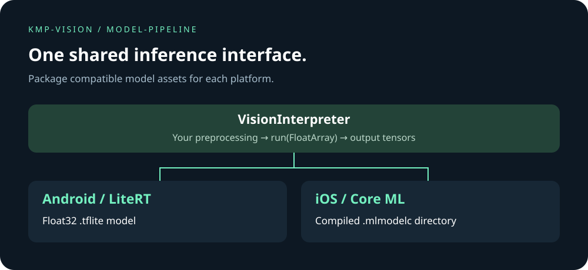

# Models

`io.github.lamplis:vision-infer` is built by `:vision-infer`. The Kotlin package is `io.github.lamplis.vision.infer`. `loadOptimizedModel(OptimizedVisionModel)` picks the file for the current platform when one object holds both the float32 `.tflite` bytes and the `.mlmodelc` directory. `loadVisionInterpreter` loads a model you already have: `ModelFormat.Tflite` plus bytes on Android, `ModelFormat.CoreMl` plus a `.mlmodelc` path on iOS. Both return the same `VisionInterpreter`. Android runs on LiteRT and keeps the GPU only when a short trial is faster than CPU. iOS runs on Core ML and uses the Neural Engine when `preferAccelerator` is true. `run` returns `VisionTensor` values. The app does not load ONNX bytes at runtime.

### Keep one ONNX file

Install the converter once, then turn that file into the two models the app loads:

```bash
pip install -r tools/requirements-vision.txt
./gradlew :vision-infer:convertVisionOnnx -PvisionOnnx=model.onnx
```

The task writes `android/<stem>.tflite` and `ios/<stem>.mlmodelc` under `vision-infer/build/vision-models`. Pass both to `loadOptimizedModel`. Android runs the TFLite file on LiteRT and uses the GPU when a short trial is faster than CPU. iOS runs the Core ML bundle on the Neural Engine. The app does not load ONNX bytes at runtime.

### Models you already have

Ship a float32 `.tflite` and a compiled `.mlmodelc` yourself. `loadVisionInterpreter` returns the same `VisionInterpreter` on both platforms. `run` returns `VisionTensor` values. Android still uses LiteRT and keeps the GPU when a short trial is faster than CPU. iOS still uses the Neural Engine when `preferAccelerator` is true. Use `loadOptimizedModel` when one `OptimizedVisionModel` holds both files.

```kotlin
// Android: float32 .tflite bytes
loadVisionInterpreter("", ModelFormat.Tflite, tfliteBytes)

// iOS: compiled .mlmodelc directory
loadVisionInterpreter(mlmodelcPath, ModelFormat.CoreMl, null)
```



## Scope and integration

The diagram describes the model-loading path; it is not an inference screenshot. Vision Lab currently demonstrates OCR and overlays and does not bundle an inference model. You supply a compatible model, its preprocessing, and interpretation of output tensors. ONNX conversion depends on supported operators and the converter toolchain. Validate your model on both platforms and measure performance on your target devices.
